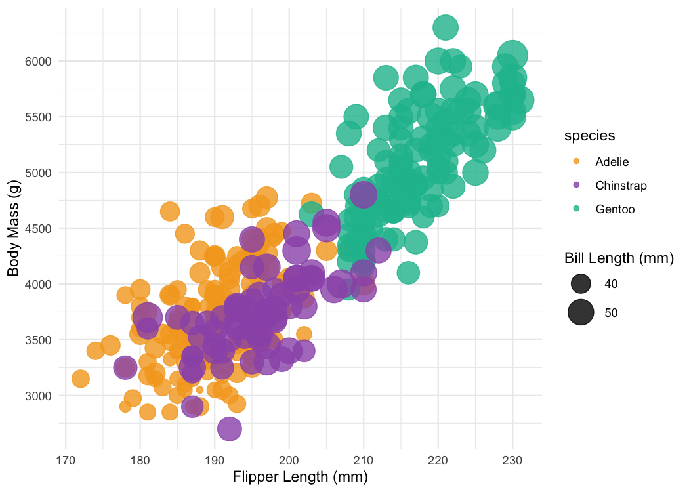
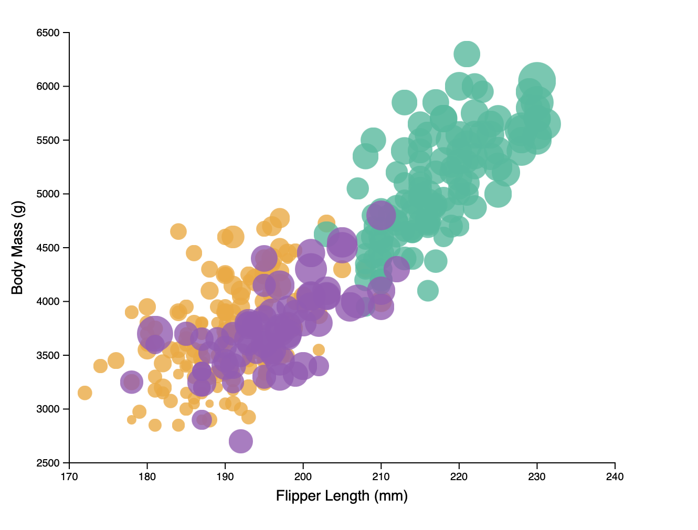
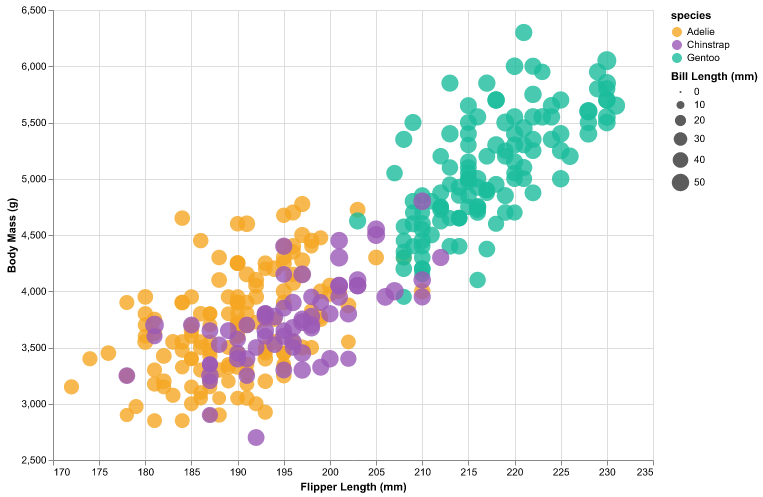
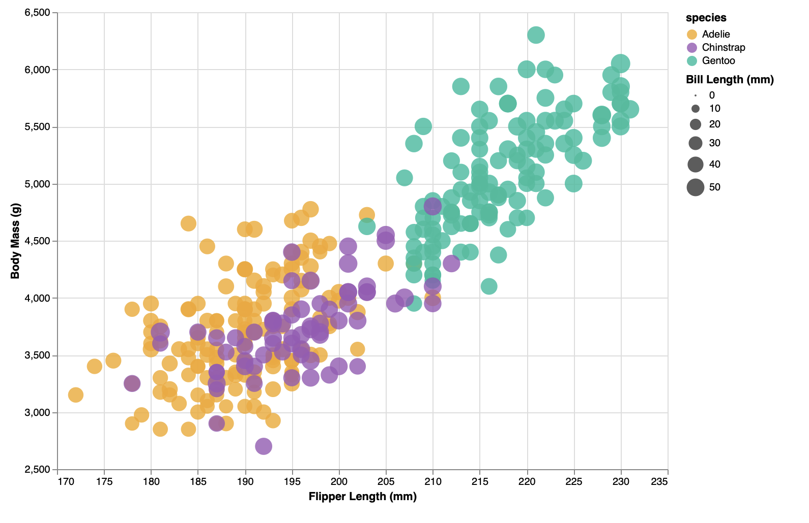
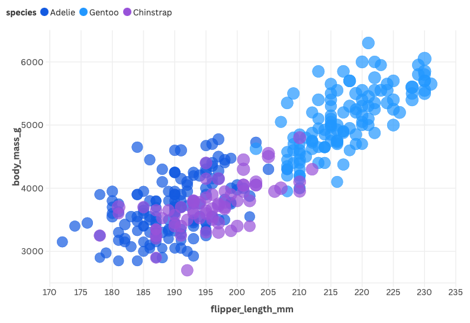
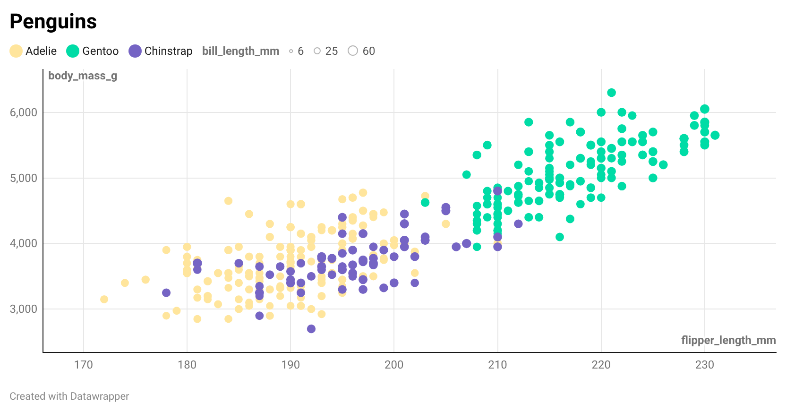
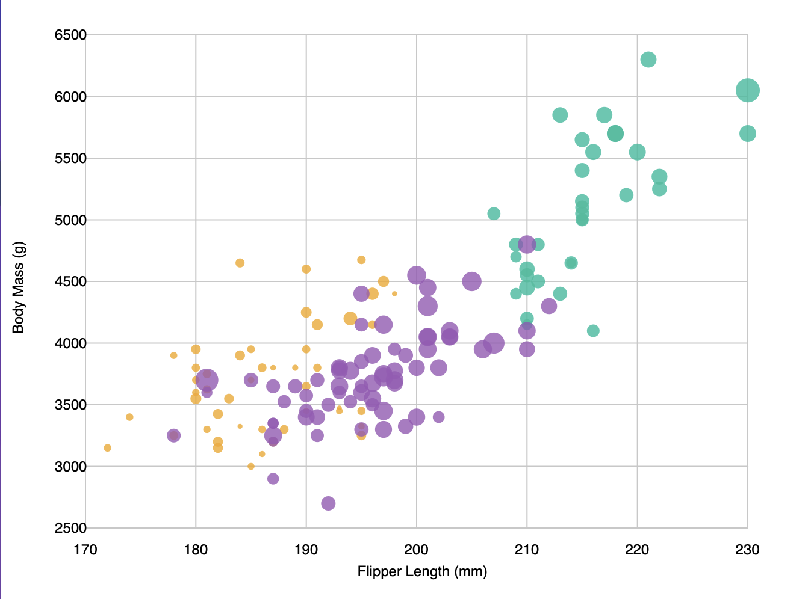

# Data Visualization, 7 Ways

Same penguin scatter in seven tools: flipper length vs body mass, colored by species, size = bill length, 0.8 opacity. Screenshots in `img/`.

---

## R + ggplot2

R + ggplot2. Chart built with `geom_point()`, color and size aesthetics, alpha 0.8.

---

## d3

d3 for the web. Load CSV with `d3.csv()`, linear scales for x/y/size, circles with opacity 0.8. Need a local server to load the CSV.

---

## Altair

Altair (Python). Pandas for CSV, drop NAs, `mark_circle()` and encodings. Saves to `img/altair.png`. Run from project root.

---

## Vega-Lite

Vega-Lite spec in `vega-lite/spec.json`. Point mark, same encodings. Use Vega Editor or `vega-lite/index.html` with a local server so the CSV loads.

---

## Flourish

Flourish (no code). Scatter, upload CSV, set x/y/color/size and opacity. Screenshot in `img/flourish.png`.

---

## DataWrapper

DataWrapper (no code). Scatter, upload CSV, map columns. Screenshot in `img/datawrapper.png`.

---

## p5.js

p5.js. Data embedded in the page so it works without a server. Circles, manual axes and labels.

---

## Technical achievements

- **Async data loading (d3):** Chart is built only after data loads using `d3.csv().then(...)`.
- **Reproducible specs (Vega-Lite, Altair):** Chart is defined in code/spec files that can be re-run or re-embedded.
- **Custom scales (p5.js):** Manual scaling and axis tick placement to match the reference.

## Design achievements

- **Consistent encoding:** Same variables (flipper length, body mass, species, bill length) and opacity (0.8) in all seven versions where the tool allowed it.
- **Aligned colors:** Adelie = orange, Chinstrap = purple, Gentoo = teal in R, d3, Altair, Vega-Lite, and p5.js.
